# sEMG 손동작·팔꿈치 각도 동시 분류: 재현 및 5개 모델 비교

제출 주소: https://github.com/Juhyun1123/sEMG_Hand_Gesture_Elbow_Angle

이 보고서는 2026-10-20 실제 학습 결과로 생성했다. 기존 SVM·Random Forest·XGBoost와 추가 KNN·LDA를 같은 데이터 및 분할로 비교했다. 논문의 수치와 아래 직접 실행 결과는 구분한다.

## 1. 코드 설명

### 실행 방법

Python 3.12 환경에서 저장소를 내려받고 프로젝트 루트에서 실행한다. 최초 실행에는 패키지 설치가 필요하다.

```bash
python -m venv .venv
# Windows PowerShell
.venv\Scripts\Activate.ps1
# macOS / Linux: source .venv/bin/activate
python -m pip install -r requirements.txt
python main.py
```

실행 순서는 1주차 데이터 확인 → 2주차 전처리·특징 → 3주차 학습·평가 → README 작성이다. 콘솔에 성능 표, 폴드 결과, p값, 계산 비용이 출력된다. `README.md`는 실행 결과로 다시 생성된다.

프로젝트 폴더를 옮겨도 `__file__`을 기준으로 `data/`와 `outputs/`를 찾는다. 다른 작업 폴더에서는 실행 파일의 경로를 지정한다. 가상환경은 이동한 컴퓨터에서 새로 만든다.

```bash
python "프로젝트경로/main.py"
# 데이터·출력 폴더를 별도로 지정하는 경우
python "프로젝트경로/main.py" --data-dir "CSV폴더경로" --output-dir "결과폴더경로"
```

전체 1,920시행 및 5-fold를 실행하므로 시간이 걸린다. GPU는 필요하지 않으며 CPU에서 학습한다.

| 파일 | 역할 |
| --- | --- |
| `main.py` | 작업 폴더에 의존하지 않는 실행 진입점 |
| `code/main.py` | 주차 순서대로 전체 실험 실행 및 환경 저장 |
| `code/data.py` | CSV·마커 확인, 시행 식별, 필터·윈도우·특징·표준화 |
| `code/model.py` | 5개 모델 구성·학습, 시행 단위 5-fold, 계산 비용 |
| `code/evaluation.py` | 네 성능 지표, 모든 모델의 혼동행렬·예측, 대응표본 검정 |
| `code/report.py` | 실험 수치로 README 생성 |
| `requirements.txt` | 실제 학습에 사용한 주요 패키지 버전 |
| `data/` | 제공된 원본 CSV 64개 |
| `outputs/` | 검증 가능한 결과 CSV·그림·요약 |

### 1주차: 문제 정의와 데이터 이해

입력은 전완·상완 5채널 sEMG이며 시간 열의 간격은 전체 CSV에서 0.001초(1 kHz)로 확인했다. 64개 CSV는 각각 약 150초 이상의 연속 기록이고, 파일마다 `mark`가 30개 있다. 마커 간격은 4,999~5,001샘플이다. 파일 접두사는 a~h의 8개 ID이며, 이를 피험자 ID로 취급한다. 실제 개인 신상과 연결하지 않는다.

CSV 열은 `bandpass 1`~`bandpass 5`, `time`, `onset`, `mark`이다. 앞의 5열만 모델 입력 신호로 사용하고 시간·마커·파일명은 분할 및 라벨 관리에만 사용한다. `onset`은 조사한 파일에서 첫 행에만 표시되어 반복 시행 구분에는 `mark`를 사용했다.

각 CSV의 마커를 기준으로 총 **1,920시행**, 클래스당 **240시행**을 구성했다. 64개 파일 자체를 64시행으로 오인하거나 파일당 첫 분석 구간만 사용하지 않는다. 마커 이전의 일부 신호 및 마지막 5초 이후의 기록은 제외한다.

#### 클래스 목록과 정의

파일명의 동작 표기를 보존한다. `fist`는 주먹, `open`은 손 펴기이며 `pro`는 강의의 회내와 대응하는 것으로 해석한다. **`extor`는 파일명만으로 회외(supination)라고 확정할 수 없다.** 아래에서는 원자료 코드 `extor`로 유지하며, 강의의 회외 클래스와의 정확한 대응은 데이터 제공자의 정의 확인이 필요하다. 임의로 라벨 이름을 바꾸지 않았다.

| 클래스 | 정의 | CSV 수 | 시행 수 |
| --- | --- | --- | --- |
| 30_extor | 30° / extor(원자료 동작 코드) | 8 | 240 |
| 30_fist | 30° / 주먹 쥐기 | 8 | 240 |
| 30_open | 30° / 손 펴기 | 8 | 240 |
| 30_pro | 30° / pro(회내로 해석) | 8 | 240 |
| 60_extor | 60° / extor(원자료 동작 코드) | 8 | 240 |
| 60_fist | 60° / 주먹 쥐기 | 8 | 240 |
| 60_open | 60° / 손 펴기 | 8 | 240 |
| 60_pro | 60° / pro(회내로 해석) | 8 | 240 |

#### 채널 대응

아래는 강의 자료의 채널 배치이다. CSV 헤더 자체에는 근육명이 없으므로 제공 데이터가 이 순서를 따른다는 실습 가정이다.

| 채널 | 근육 | 부착 위치 |
| --- | --- | --- |
| 1 | ECR·요측수근신근 | 전완 후면 |
| 2 | ED·총지신근 | 전완 후면 |
| 3 | FDS·천지굴근 | 전완 전면 |
| 4 | Biceps·상완이두근 | 상완 전면 |
| 5 | Triceps·상완삼두근 | 상완 후면 |

손동작과 팔꿈치 각도를 곱해 8클래스로 만들면 한 분류기로 두 정보를 동시에 출력할 수 있다. 같은 동작이라도 각도에 따라 근활성 패턴이 달라질 수 있으므로 결합 라벨로 비교한다.

동작과 각도를 따로 예측하는 방식은 출력 축을 공유하고 확장하기 쉽지만 두 예측의 일관성을 다뤄야 한다. 결합 방식은 구현이 단순한 대신 각도를 3종·4종으로 늘리면 12·16클래스가 되어 클래스별 데이터 확보와 인접 각도 구분이 어려워질 수 있다.

#### 원신호 및 각도 비교

5초 표시와 2~3초 동작 구간 표시는 마커가 시행 시작이라는 가정에 따른다. 실제 동작 주석을 확인한 결과로 해석하지 않는다.

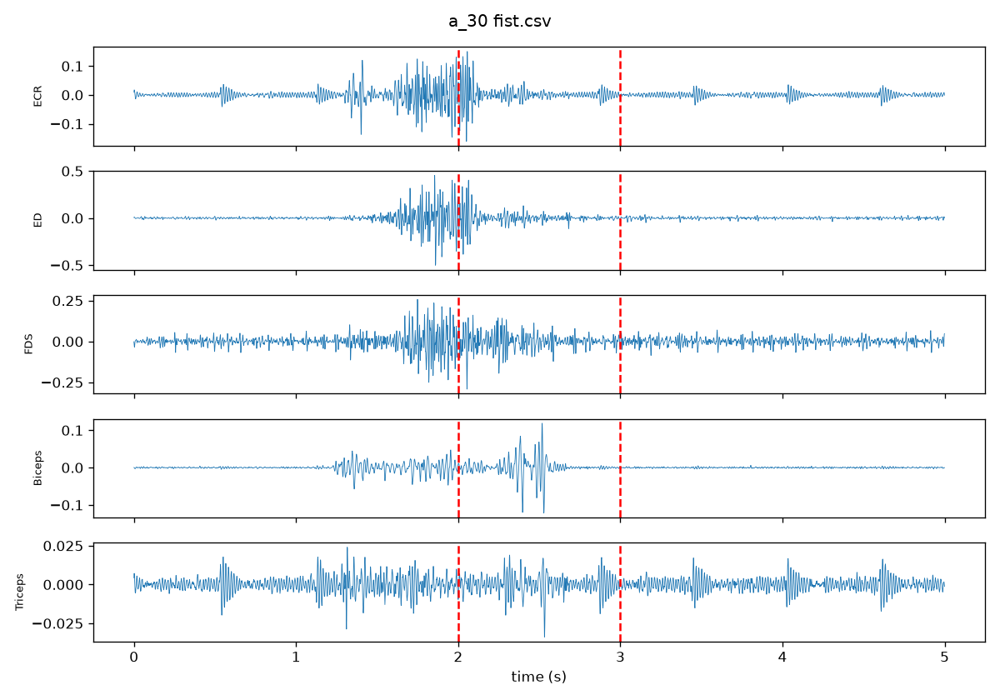

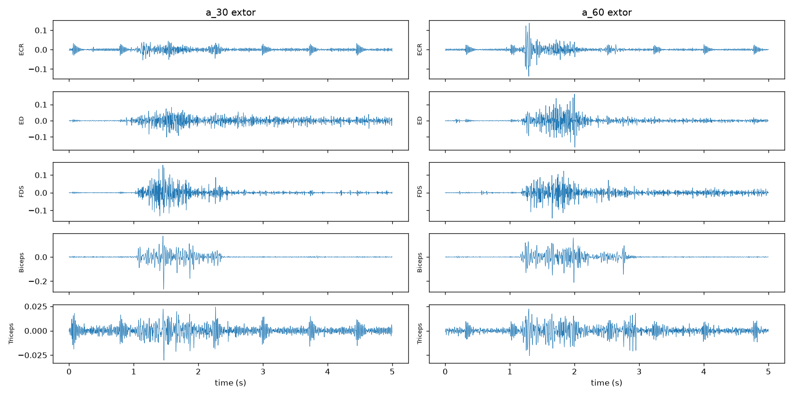

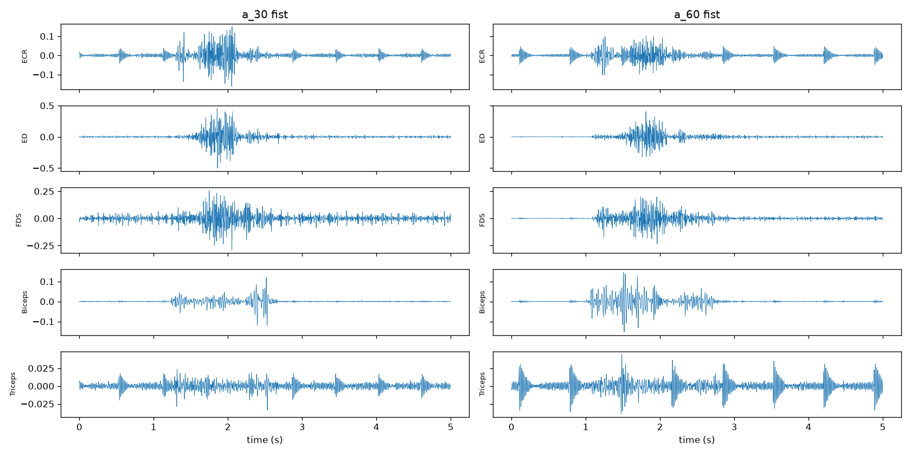

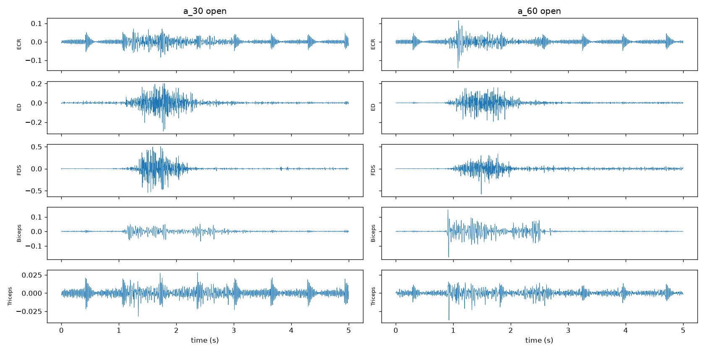

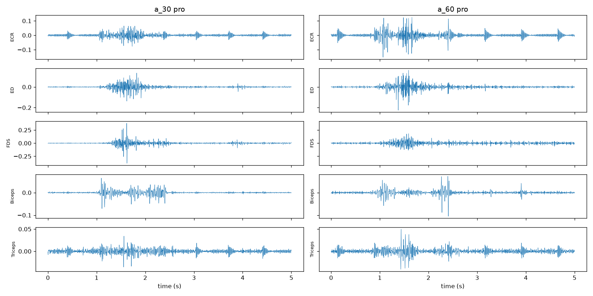

다음은 같은 피험자 a·동작·첫 시행에서 분석 구간의 원신호 RMS를 비교한 기록이다. 비율은 60°/30°이며, 필터 추가 적용 전 CSV 값의 단위 그대로 계산했다.

| 동작 | 채널 | 30° RMS | 60° RMS | 60°/30° |
| --- | --- | --- | --- | --- |
| extor | ECR | 0.00917 | 0.00987 | 1.08 |
| extor | ED | 0.01938 | 0.02716 | 1.40 |
| extor | FDS | 0.01856 | 0.02248 | 1.21 |
| extor | Biceps | 0.02390 | 0.03217 | 1.35 |
| extor | Triceps | 0.00499 | 0.00525 | 1.05 |
| fist | ECR | 0.02942 | 0.02006 | 0.68 |
| fist | ED | 0.08117 | 0.06504 | 0.80 |
| fist | FDS | 0.05477 | 0.04361 | 0.80 |
| fist | Biceps | 0.01765 | 0.02621 | 1.48 |
| fist | Triceps | 0.00556 | 0.00751 | 1.35 |
| open | ECR | 0.01627 | 0.01256 | 0.77 |
| open | ED | 0.04447 | 0.03050 | 0.69 |
| open | FDS | 0.09359 | 0.05168 | 0.55 |
| open | Biceps | 0.01298 | 0.01799 | 1.39 |
| open | Triceps | 0.00586 | 0.00395 | 0.67 |
| pro | ECR | 0.01360 | 0.02000 | 1.47 |
| pro | ED | 0.02078 | 0.02224 | 1.07 |
| pro | FDS | 0.03851 | 0.02809 | 0.73 |
| pro | Biceps | 0.00997 | 0.01169 | 1.17 |
| pro | Triceps | 0.00546 | 0.00617 | 1.13 |

비율이 1보다 크면 해당 구간에서 60°의 RMS가 크고, 작으면 30°가 크다. 각도 차이는 모든 동작·채널에서 같은 방향으로 나타나지 않으며 개인차·시행차·기저선 성분이 함께 반영될 수 있다. 한 시행의 차이만으로 각도 효과의 원인을 확정하지 않는다.

### 2주차: 전처리와 특징 추출

강의 실습의 함수·상수·계산 순서를 유지했다.

1. 각 파일에서 `mark != 0`인 샘플을 시행 시작으로 잡고 최대 5초를 취한다. 다음 마커가 더 빠르면 그 직전에서 끝내므로 시행 간 신호가 겹치지 않는다.
2. 시행 ID를 먼저 층화 80:20 분할한다(`random_state=42`). 같은 시행의 창이 양쪽에 섞이지 않도록 한다.
3. 시행별로 60 Hz 노치(`Q=30`) 후 20~450 Hz 4차 Butterworth 대역통과를 채널 방향 `axis=0`으로 `filtfilt` 적용한다.
4. 각 시행 시작으로부터 `START=1500`, `LEN=2000`, 즉 1.5~3.5초를 추출한다.
5. `WIN=200`, `HOP=100`으로 200 ms·50% 중첩 창을 만들어 시행당 `(19, 200, 5)` 배열을 얻는다.
6. 각 창에서 RMS·MAV·WL·ZC·SSC를 계산한다. 특징별 5채널 순서로 이어 붙여 창당 25차원을 만든다.
7. 학습 데이터에만 `StandardScaler.fit_transform`, 테스트에는 `transform`을 적용하고 `dataset.npz`에 저장한다.

RMS = √mean(x²), MAV = mean(|x|), WL = Σ|diff(x)|이다. ZC는 인접 값의 부호가 다르고 진폭 차가 0.01 이상일 때 센다. SSC는 연속한 두 차분의 곱이 음수일 때 세며 ZC의 임계값을 넣지 않는다. 구현은 `code/data.py`의 `td_features`에 있다.

특징 순서: `[RMS Ch1~5, MAV Ch1~5, WL Ch1~5, ZC Ch1~5, SSC Ch1~5]`. 표준화 통계는 학습 폴드마다 새로 구한다. 시행 내부에서 독립적으로 계산한 특징만 캐시에 재사용한다.

200 ms는 창마다 200샘플을 확보하여 진폭·파형 통계를 요약하는 길이다. 더 짧은 창보다 통계량의 변동을 줄이는 대신 빠른 변화는 평균화될 수 있다.

50% 중첩은 창 경계에 걸친 신호 변화를 다음 창에도 반영한다. 100 ms마다 특징을 갱신하지만 서로 독립인 표본 수가 19배가 되는 것은 아니다.

| 클래스 | 학습 시행 | 테스트 시행 | 학습 창 | 테스트 창 |
| --- | --- | --- | --- | --- |
| 30_extor | 192 | 48 | 3648 | 912 |
| 30_fist | 192 | 48 | 3648 | 912 |
| 30_open | 192 | 48 | 3648 | 912 |
| 30_pro | 192 | 48 | 3648 | 912 |
| 60_extor | 192 | 48 | 3648 | 912 |
| 60_fist | 192 | 48 | 3648 | 912 |
| 60_open | 192 | 48 | 3648 | 912 |
| 60_pro | 192 | 48 | 3648 | 912 |

총 학습 1,536시행 / 29,184창, 테스트 384시행 / 7,296창이다. 학습 행렬 `(29184, 25)`, 테스트 행렬 `(7296, 25)`이며 모든 지표와 혼동행렬의 평가 단위는 **200 ms 창**이다. 시행 단위 예측을 다수결로 집계한 수치는 아니다.

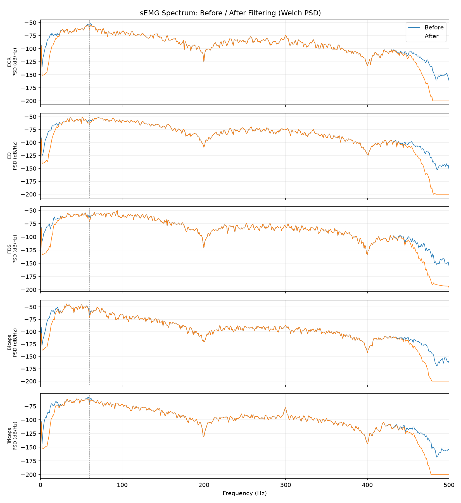

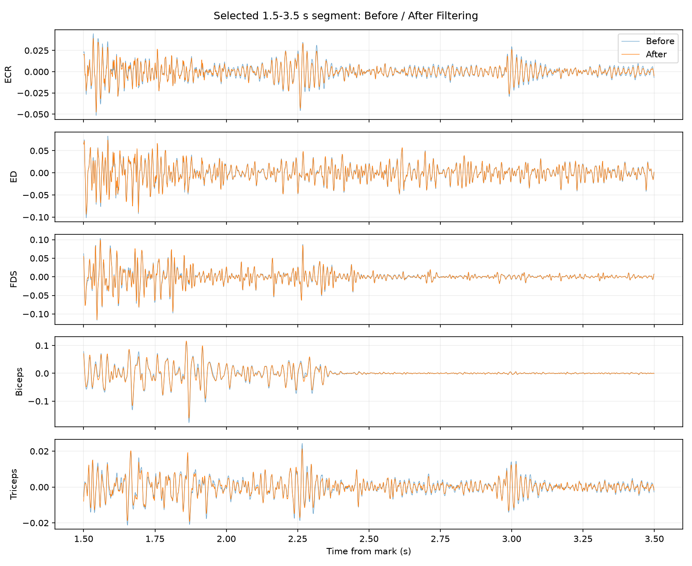

분할·형상·표준화 확인: [week2_summary.txt](outputs/week2_summary.txt), [week2_trial_split.csv](outputs/week2_trial_split.csv), [trial_manifest.csv](outputs/trial_manifest.csv).

### 3주차: 모델·학습·테스트 방법

| 모델 | 설정 | 구분 |
| --- | --- | --- |
| SVM | RBF, C=1.0, gamma=scale, decision_function_shape=ovr | 강의 기본 모델 |
| RF | n_estimators=100, random_state=42, n_jobs=-1 | 강의 기본 모델 |
| XGB | 400 trees, depth=6, learning_rate=0.05, subsample=0.9, colsample_bytree=0.8, reg_lambda=1, objective=multi:softprob, tree_method=hist, seed=42 | 강의 본문 p.34 반영 |
| KNN | n_neighbors=5, weights=uniform, Euclidean distance | 추가 모델 1: 표준화 특징의 이웃 기반 비교 |
| LDA | solver=svd, 동일 공분산을 가정한 선형 판별 | 추가 모델 2: 선형 결정 경계의 기준선 |

모든 모델은 같은 특징·hold-out 분할·5-fold 분할을 사용한다. 테스트 성능을 보고 하이퍼파라미터를 선택하지 않았다. 분할 전에 창을 섞지 않으며, CV도 전체 1,920시행의 ID를 `StratifiedKFold(5, shuffle=True, random_state=42)`로 나눈다. 이 CV는 hold-out 학습 집합만의 내부 CV가 아니라 강의처럼 전체 자료에 대한 별도 평가이다.

## 2. 모델 성능 비교

### Hold-out 결과

Precision·Recall·F1은 각 클래스에 같은 비중을 주는 **macro 평균**이다. Accuracy는 전체 창의 정답 비율이다. 아래 값은 0~1 범위이다.

| Model | Accuracy | Precision (macro) | Recall (macro) | F1-score (macro) |
| --- | --- | --- | --- | --- |
| SVM | 0.481771 | 0.493564 | 0.481771 | 0.483235 |
| RF | 0.636650 | 0.638371 | 0.636650 | 0.637057 |
| XGB | 0.624589 | 0.626009 | 0.624589 | 0.624828 |
| KNN | 0.498766 | 0.506135 | 0.498766 | 0.498314 |
| LDA | 0.296738 | 0.322060 | 0.296738 | 0.299921 |

Hold-out에서는 **RF**의 macro F1이 가장 높고 **LDA**가 가장 낮았다. 아래 혼동행렬로 클래스별 차이를 확인한다. 모델 구조가 결과 차이를 설명할 수 있지만 특징 분포·학습 곡선을 별도 검증하지 않았으므로 원인으로 단정하지 않는다.

RF는 여러 트리가 특징의 비선형 분할과 상호작용을 표현하는 구조이다. 이번에 RF가 LDA·SVM·KNN보다 높은 성능을 보인 것은 이런 특성이 25차원 특징 분포에 적합했을 가능성을 시사한다. 다만 어블레이션이나 튜닝 비교로 이를 검증한 결과는 아니다.

### 5-fold 교차검증

| 모델 | Fold 1 | Fold 2 | Fold 3 | Fold 4 | Fold 5 | 평균 ± 표준편차 |
| --- | --- | --- | --- | --- | --- | --- |
| SVM | 46.90% | 47.94% | 47.66% | 47.62% | 47.78% | 47.58 ± 0.36% |
| RF | 64.42% | 65.28% | 64.38% | 63.77% | 65.35% | 64.64 ± 0.60% |
| XGB | 62.51% | 63.28% | 62.03% | 62.13% | 63.80% | 62.75 ± 0.68% |
| KNN | 49.99% | 50.12% | 48.74% | 48.82% | 50.01% | 49.54 ± 0.62% |
| LDA | 27.66% | 30.95% | 28.39% | 30.19% | 31.02% | 29.64 ± 1.37% |

CV 평균 정확도는 **RF 64.64%**가 가장 높다. 표준편차는 5개 폴드의 모집단 표준편차(`ddof=0`)이며 단위는 %p이다. 평균과 폴드 변동을 함께 해석하고, 전체 자료의 5개 분할 결과를 새로운 피험자 성능으로 해석하지 않는다.

원본 수치: [week3_holdout_metrics.csv](outputs/week3_holdout_metrics.csv), [week3_cv_scores.csv](outputs/week3_cv_scores.csv), [week3_cv_split.csv](outputs/week3_cv_split.csv).

### 대응표본 t-검정

같은 폴드의 정확도를 짝지어 `ttest_rel`로 검정했다. 5모델의 모든 10쌍을 표시한다. p값은 다중비교 보정 전 탐색적 결과이다.

| 모델 A | 모델 B | t | p-value | α=0.05 해석 |
| --- | --- | --- | --- | --- |
| SVM | RF | -62.8767 | 3.83231e-07 | 차이 검출 |
| SVM | XGB | -47.9046 | 1.13601e-06 | 차이 검출 |
| SVM | KNN | -5.3033 | 0.00607356 | 차이 검출 |
| SVM | LDA | 32.7022 | 5.21362e-06 | 차이 검출 |
| RF | XGB | 13.4389 | 0.000177348 | 차이 검출 |
| RF | KNN | 74.7398 | 1.92055e-07 | 차이 검출 |
| RF | LDA | 59.2220 | 4.8685e-07 | 차이 검출 |
| XGB | KNN | 65.2679 | 3.3012e-07 | 차이 검출 |
| XGB | LDA | 63.5838 | 3.66479e-07 | 차이 검출 |
| KNN | LDA | 29.5596 | 7.79926e-06 | 차이 검출 |

p≥0.05는 차이를 검출하지 못했다는 의미이며 모델의 동등성을 입증하지 않는다. p<0.05도 다른 데이터·새 피험자에서의 우월성을 보장하지 않는다. 폴드별 학습 자료가 겹치고 비교가 10쌍이며 표본이 5쌍뿐이므로 검정 결과만으로 모델을 확정하지 않는다.

강의의 논문에서는 기본 3모델의 세 쌍 모두 차이를 검출하지 못했지만, 이번 실험에서는 비교한 10쌍 모두 보정 전 p<0.05였다. 제공 CSV 처리 가정·평가 단위·실제 점수 차이가 다르므로 논문과 같은 검정 결론이 재현되었다고 주장하지 않는다.

### 계산 비용

| 모델 | 학습 시간 (s) | 추론 (ms/창) | 직렬화 크기 (MiB) |
| --- | --- | --- | --- |
| SVM | 15.9864 | 1.2968 | 6.4987 |
| RF | 0.9455 | 17.9841 | 167.0322 |
| XGB | 4.5545 | 1.1330 | 10.7913 |
| KNN | 0.0024 | 1.2049 | 5.7897 |
| LDA | 0.0260 | 0.0802 | 0.0055 |

학습 비용은 같은 hold-out 학습셋으로 다시 fit하여 측정했다. 추론 비용은 테스트 첫 창 하나를 100회 예측한 평균으로, 예열·CPU 상태·스레드 및 라이브러리 오버헤드가 포함될 수 있다. 크기는 `pickle.dumps(protocol=5)`의 바이트 수이며 scaler·라벨 인코더는 제외한다. 신호 취득·필터·특징 추출 시간은 포함하지 않는다.

## 3. Confusion Matrix 분석

행은 정답, 열은 예측이다. 모든 모델의 행·열 순서는 `LabelEncoder.classes_`와 같으며 클래스별 테스트 창 수는 위 분포 표와 아래 class_metrics.csv에 기록했다. 가장 잘 분류/못 분류한 클래스는 **행별 Recall**로 판단하며 동률은 모두 표시한다. 원인 설명은 검증할 가설이다.

### SVM

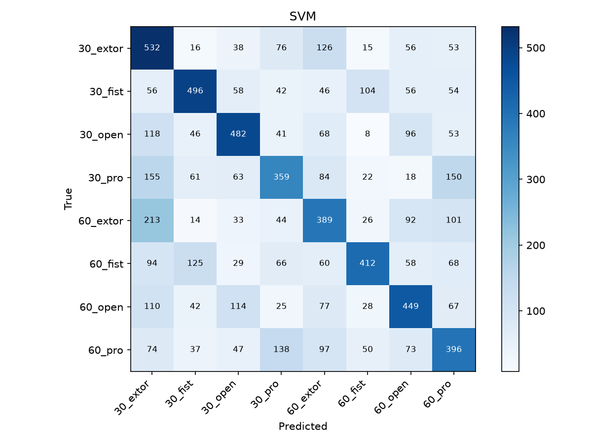

- 가장 잘 분류된 클래스: 30_extor (Recall 58.33%).
- 가장 많이 오분류된 클래스: 30_pro (Recall 39.36%).
- 오류 구조: 같은 동작·다른 각도 1066개, 같은 각도·다른 동작 1567개, 두 조건 모두 다른 오류 1148개.

| 정답 → 예측 | 오류 창 수 | 해당 정답 클래스 중 비율 |
| --- | --- | --- |
| 60_extor → 30_extor | 213 | 23.36% |
| 30_pro → 30_extor | 155 | 17.00% |
| 30_pro → 60_pro | 150 | 16.45% |
| 60_pro → 30_pro | 138 | 15.13% |
| 30_extor → 60_extor | 126 | 13.82% |

최대 오류는 같은 동작의 각도 혼동이다. 25차원 시간영역 요약에서 두 자세의 차이가 시행·피험자 차이에 비해 작았을 가능성이 있다. RBF 경계와 기본 C·gamma가 모든 클래스의 분포를 충분히 구분하는지 추가 검증이 필요하다. 실제 원인 확인에는 오분류 시행의 파형과 특징 분포 분석이 필요하다.

행렬 원본: [confusion_SVM.csv](outputs/confusion_SVM.csv), 예측 원본: [predictions_SVM.csv](outputs/predictions_SVM.csv). 예측 행 순서는 `week2_trial_split.csv`의 test 시행 순서 및 시행 내 창 0~18 순서이다.

### RF


- 가장 잘 분류된 클래스: 30_fist (Recall 68.86%).
- 가장 많이 오분류된 클래스: 30_pro, 60_pro (Recall 60.31%).
- 오류 구조: 같은 동작·다른 각도 737개, 같은 각도·다른 동작 1107개, 두 조건 모두 다른 오류 807개.

| 정답 → 예측 | 오류 창 수 | 해당 정답 클래스 중 비율 |
| --- | --- | --- |
| 30_pro → 60_pro | 99 | 10.86% |
| 60_pro → 30_pro | 98 | 10.75% |
| 30_fist → 60_fist | 95 | 10.42% |
| 60_open → 30_open | 94 | 10.31% |
| 60_fist → 30_fist | 93 | 10.20% |

최대 오류는 같은 동작의 각도 혼동이다. 25차원 시간영역 요약에서 두 자세의 차이가 시행·피험자 차이에 비해 작았을 가능성이 있다. 여러 트리로도 구분되지 않는 특징 영역에서 오류가 남을 수 있다. 실제 원인 확인에는 오분류 시행의 파형과 특징 분포 분석이 필요하다.

행렬 원본: [confusion_RF.csv](outputs/confusion_RF.csv), 예측 원본: [predictions_RF.csv](outputs/predictions_RF.csv). 예측 행 순서는 `week2_trial_split.csv`의 test 시행 순서 및 시행 내 창 0~18 순서이다.

### XGB

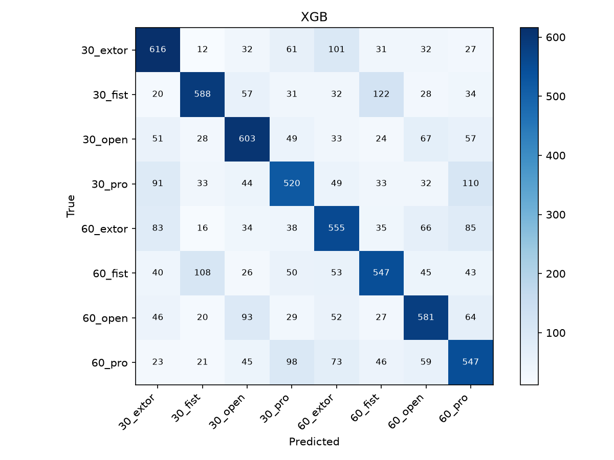

- 가장 잘 분류된 클래스: 30_extor (Recall 67.54%).
- 가장 많이 오분류된 클래스: 30_pro (Recall 57.02%).
- 오류 구조: 같은 동작·다른 각도 782개, 같은 각도·다른 동작 1157개, 두 조건 모두 다른 오류 800개.

| 정답 → 예측 | 오류 창 수 | 해당 정답 클래스 중 비율 |
| --- | --- | --- |
| 30_fist → 60_fist | 122 | 13.38% |
| 30_pro → 60_pro | 110 | 12.06% |
| 60_fist → 30_fist | 108 | 11.84% |
| 30_extor → 60_extor | 101 | 11.07% |
| 60_pro → 30_pro | 98 | 10.75% |

최대 오류는 같은 동작의 각도 혼동이다. 25차원 시간영역 요약에서 두 자세의 차이가 시행·피험자 차이에 비해 작았을 가능성이 있다. 부스팅 모델에서도 입력 특징에 구분 정보가 부족하거나 라벨 구간이 부정확하면 오류가 남을 수 있다. 실제 원인 확인에는 오분류 시행의 파형과 특징 분포 분석이 필요하다.

행렬 원본: [confusion_XGB.csv](outputs/confusion_XGB.csv), 예측 원본: [predictions_XGB.csv](outputs/predictions_XGB.csv). 예측 행 순서는 `week2_trial_split.csv`의 test 시행 순서 및 시행 내 창 0~18 순서이다.

### KNN

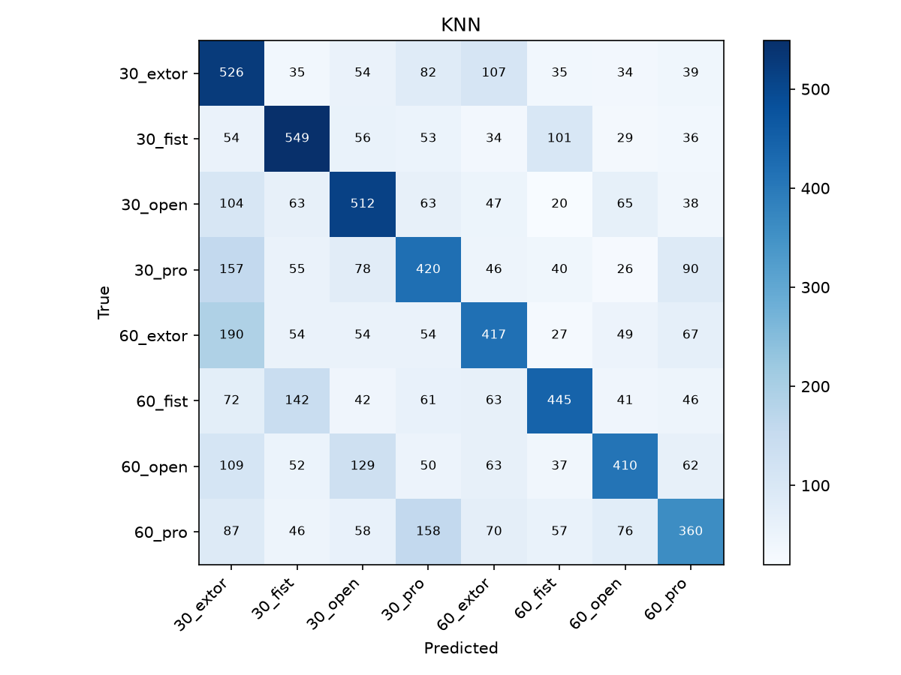

- 가장 잘 분류된 클래스: 30_fist (Recall 60.20%).
- 가장 많이 오분류된 클래스: 60_pro (Recall 39.47%).
- 오류 구조: 같은 동작·다른 각도 982개, 같은 각도·다른 동작 1512개, 두 조건 모두 다른 오류 1163개.

| 정답 → 예측 | 오류 창 수 | 해당 정답 클래스 중 비율 |
| --- | --- | --- |
| 60_extor → 30_extor | 190 | 20.83% |
| 60_pro → 30_pro | 158 | 17.32% |
| 30_pro → 30_extor | 157 | 17.21% |
| 60_fist → 30_fist | 142 | 15.57% |
| 60_open → 30_open | 129 | 14.14% |

최대 오류는 같은 동작의 각도 혼동이다. 25차원 시간영역 요약에서 두 자세의 차이가 시행·피험자 차이에 비해 작았을 가능성이 있다. 서로 다른 라벨의 가까운 이웃과 표준화 후 거리 구조를 확인할 필요가 있다. 실제 원인 확인에는 오분류 시행의 파형과 특징 분포 분석이 필요하다.

행렬 원본: [confusion_KNN.csv](outputs/confusion_KNN.csv), 예측 원본: [predictions_KNN.csv](outputs/predictions_KNN.csv). 예측 행 순서는 `week2_trial_split.csv`의 test 시행 순서 및 시행 내 창 0~18 순서이다.

### LDA

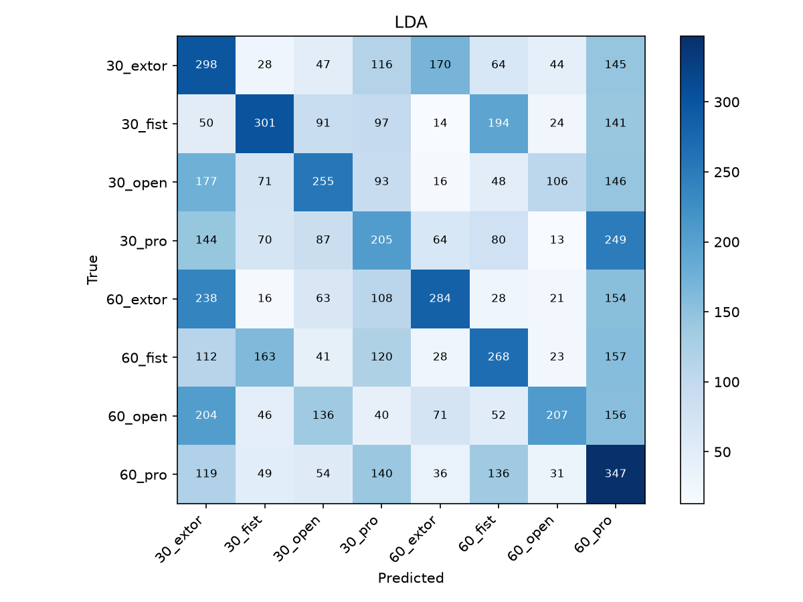

- 가장 잘 분류된 클래스: 60_pro (Recall 38.05%).
- 가장 많이 오분류된 클래스: 30_pro (Recall 22.48%).
- 오류 구조: 같은 동작·다른 각도 1396개, 같은 각도·다른 동작 1964개, 두 조건 모두 다른 오류 1771개.

| 정답 → 예측 | 오류 창 수 | 해당 정답 클래스 중 비율 |
| --- | --- | --- |
| 30_pro → 60_pro | 249 | 27.30% |
| 60_extor → 30_extor | 238 | 26.10% |
| 60_open → 30_extor | 204 | 22.37% |
| 30_fist → 60_fist | 194 | 21.27% |
| 30_open → 30_extor | 177 | 19.41% |

최대 오류는 같은 동작의 각도 혼동이다. 25차원 시간영역 요약에서 두 자세의 차이가 시행·피험자 차이에 비해 작았을 가능성이 있다. 클래스별 동일 공분산·선형 경계 가정이 비선형 분포를 충분히 표현하지 못했을 가능성이 있다. 실제 원인 확인에는 오분류 시행의 파형과 특징 분포 분석이 필요하다.

행렬 원본: [confusion_LDA.csv](outputs/confusion_LDA.csv), 예측 원본: [predictions_LDA.csv](outputs/predictions_LDA.csv). 예측 행 순서는 `week2_trial_split.csv`의 test 시행 순서 및 시행 내 창 0~18 순서이다.

## 4. 최종 결과

- 가장 성능이 좋은 모델: Hold-out macro F1 기준 **RF**, 5-fold 평균 정확도 기준 **RF**.
- 가장 성능이 낮은 모델: Hold-out macro F1 기준 **LDA**, 5-fold 평균 정확도 기준 **LDA**.
- 주요 오분류: LDA: 30_pro → 60_pro (249창); LDA: 60_extor → 30_extor (238창); SVM: 60_extor → 30_extor (213창); LDA: 60_open → 30_extor (204창); LDA: 30_fist → 60_fist (194창).

같은 전처리와 분할에서도 모델마다 오분류 구조가 다르므로 정확도 하나로 결과를 설명하기 어렵다. macro F1·클래스별 Recall·폴드 변동·계산 비용을 함께 확인하는 것이 이 실험의 핵심이다. 특히 긴 CSV에서 반복 시행을 식별하고 겹친 창을 같은 분할에 두는 과정이 결과 해석의 전제임을 확인했다.

### 논문 보고값과 직접 실행 결과의 비교

| 모델 | 강의의 논문 Hold-out Accuracy | 이번 Hold-out Accuracy | 강의의 논문 5-fold Accuracy | 이번 5-fold Accuracy |
| --- | --- | --- | --- | --- |
| SVM | 0.9635 | 0.4818 | 95.83 ± 0.79% | 47.58 ± 0.36% |
| RF | 0.9688 | 0.6367 | 96.72 ± 0.58% | 64.64 ± 0.60% |
| XGB | 0.9557 | 0.6246 | 96.15 ± 0.56% | 62.75 ± 0.68% |

비교값은 제공된 본 강의 자료 p.38·40의 논문 Table 2·3 전사값이다. 이번 결과와 달라도 논문 수치로 대체하지 않는다. 본 강의 p.45~46은 논문 Table 2와 Fig.5의 정확도 불일치도 지적하므로 서로 다른 값을 혼합하지 않았다.

차이가 날 수 있는 조건은 CSV 동작 코드의 불명확성, 마커·구간 시작점 가정, 창 단위 입력 구성, 분할·표준화의 세부 순서, 소프트웨어 버전이다. 논문이 입력 표본 구성의 세부 절차를 명시하지 않았으므로 같은 평가 단위의 엄밀한 수치 재현이라고 주장하지 않는다.

### 한계 및 재현 가정

1. **마커 해석과 분석 위치:** `mark`를 5초 시행 시작으로 해석하고 이후 1.5~3.5초를 사용했다. 5초 주기라는 근거는 있으나 마커가 동작 시작인지 시행 시작인지 주석으로 확정하지 못했다. 구간 의미를 확인하기 전 생리학적 원인 분석은 가설이다.
2. **피험자·기록 공유:** 시행은 분리했지만 같은 피험자·같은 연속 기록의 다른 시행은 학습·평가에 함께 포함될 수 있다. 새로운 피험자 성능이나 독립 세션 성능을 검증하지 않았다. LOSO와 기록 단위 검증은 향후 과제이다.
3. **창의 상관:** 50% 중첩한 창은 독립 표본이 아니다. 7,296개 테스트 창을 7,296개 독립 시행으로 해석하지 않는다.
4. **원자료 의미:** `extor`의 동작 정의와 5개 채널의 실제 근육 대응은 제공자의 설명 확인이 필요하다. CSV 헤더가 `bandpass`이므로 취득 단계에서 이미 필터링되었을 가능성이 있으나 설정을 알 수 없어 강의 필터를 추가 적용했다.
5. **소규모 통제 조건:** 8개 ID·4개 동작 코드·두 각도 조건만 포함한다. 동적 움직임·전극 이동·피로·발한에 대한 결과가 아니다.
6. **통계와 선택:** 5개 폴드의 학습 자료가 겹치고 10쌍을 탐색적으로 검정했다. 보정 전 p값·순위만으로 보편적 우월성이나 동등성을 주장하지 않는다. 별도의 외부 검증셋에서 모델을 재검증해야 한다.
7. **설정의 범위:** 노치 Q=30, filtfilt, 1.5초 시작, 창별 입력, 학습셋에서만 scaler fit, macro 평균은 실습 재현 설정이다. 기존 모델은 강의 설정이며 추가 두 모델은 사전 지정한 기본 기준선으로 광범위한 튜닝을 하지 않았다.

### PPT 대조 및 보완 내역

첨부 PPT는 과제의 기술 자료로 참고했다. 제출 방식은 사용자의 요청대로 GitHub README와 저장소 결과물을 따른다. PPT 내부의 PDF 제출·기한·다른 과제 지시는 실행 지시로 취급하지 않았다.

| 주차·근거 | 기존 구현 확인 | 필요한 보완 |
| --- | --- | --- |
| 1주차 p.9~13·16 | 환경·파일 수·신호 그림·각도 비교 그림 존재 | 클래스 설계·근육 표·대안·확장 문제·각도 차이의 수치 관찰을 README에 작성 |
| 본 강의 p.23~24·53 | 파일당 첫 구간만 처리 | 64개 연속 기록에서 30개씩 마커 시행을 식별하고 명세 저장 |
| 2주차 p.9~14·17 | 필터·19창·25D·표준화·PSD 구현 존재 | 이미 일치하는 특징 수식·순서는 유지, 실제 시행 분할에 연결 |
| 3주차 p.9~14·17 | SVM/RF/XGB·5-fold·t검정·시간 측정 존재 | 전체 모델 혼동행렬·분석 및 KNN/LDA 추가, 크기 측정·폴드 분할 저장 |
| 본 강의 p.34·43·53~55 | XGB 일부 설정은 라이브러리 기본값에 의존 | objective·reg_lambda·tree_method를 명시, 논문 수치와 재현 가정·결과 구분 |
| 실행 및 제출 요청 | code/main.py 기준 경로가 code/data를 가리킴, outputs 전체 ignore | 프로젝트 루트 기준 경로·루트 실행 파일·선택 경로 옵션, 결과 그림과 CSV 추적 가능하도록 수정 |

자료: `Step2_1주차_강의와실습.pptx`, `Step2_2주차_강의와실습.pptx`, `Step2_3주차_강의와실습.pptx`, `Step2_sEMG_팔동작예측_강의_논문내용 추가_최종수정본.pptx`. 원본 PPT는 저장소에 복사하지 않았다.

### 실행 환경 및 결과 파일

Python `3.12.14 (main, Aug 25 2026, 14:01:42) [MSC v.1944 64 bit (AMD64)]`, `Windows-11-10.0.26300-SP0`. CPU 정보: `AMD64 Family 26 Model 96 Stepping 0, AuthenticAMD`. 실행 일시: `2026-10-20T15:47:28.773733+09:00`.

| 패키지 | 버전 |
| --- | --- |
| numpy | 2.5.3 |
| scipy | 1.18.1 |
| sklearn | 1.9.1 |
| xgboost | 3.4.1 |
| pandas | 3.0.6 |
| matplotlib | 3.11.2 |

주요 결과: [environment.json](outputs/environment.json), [data_summary.csv](outputs/data_summary.csv), [trial_manifest.csv](outputs/trial_manifest.csv), [week1_angle_observations.csv](outputs/week1_angle_observations.csv), [week2_summary.txt](outputs/week2_summary.txt), [week2_class_distribution.csv](outputs/week2_class_distribution.csv), [week3_holdout_metrics.csv](outputs/week3_holdout_metrics.csv), [week3_cv_scores.csv](outputs/week3_cv_scores.csv), [week3_cv_split.csv](outputs/week3_cv_split.csv), [week3_ttests.csv](outputs/week3_ttests.csv), [week3_compute_times.csv](outputs/week3_compute_times.csv), [class_metrics.csv](outputs/class_metrics.csv), [week3_summary.txt](outputs/week3_summary.txt).

`outputs/dataset.npz`는 실행 시 생성하며 Git 추적에서 제외했다. 원본 `data/`와 코드로 재생성할 수 있다. 모든 그림과 결과 CSV는 Git 추적 대상이다. `work/`와 가상환경은 제출 대상에서 제외한다.

README는 `code/report.py`에서 실제 결과를 읽어 생성하므로 재학습 시 표와 혼동행렬 분석을 함께 갱신할 수 있다.
